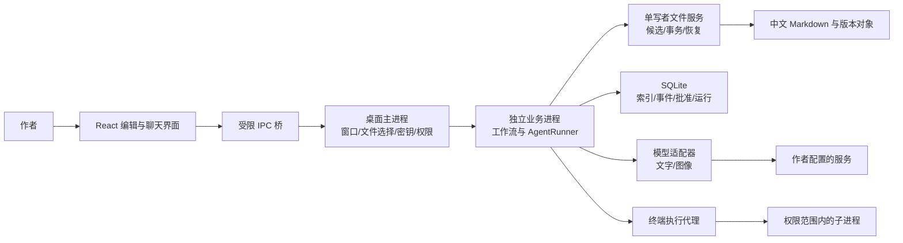
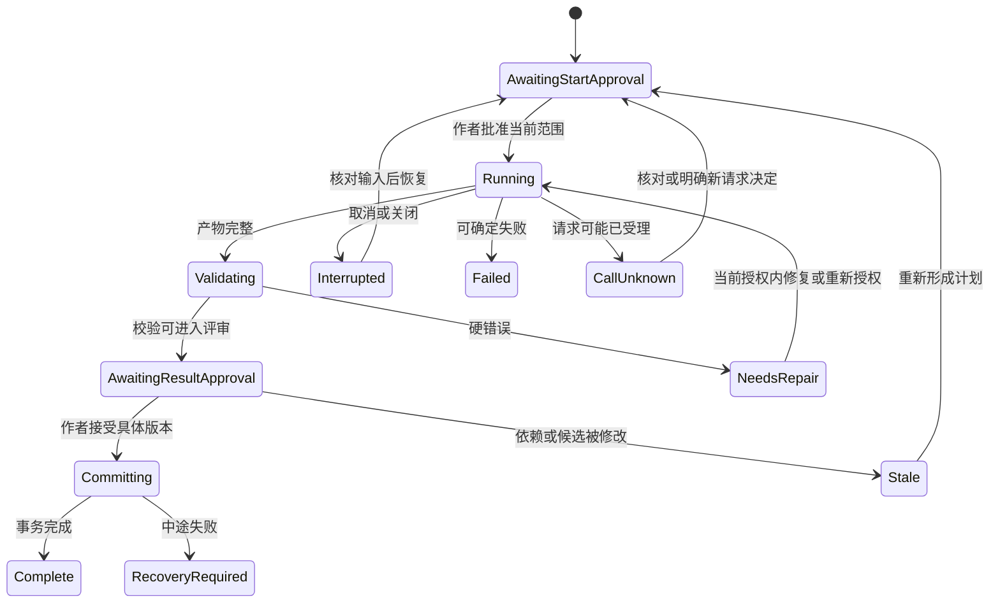

# 技术设计文档

2026-10-08 已批准并实现的增补：独立对话内核、任务卡、角色模块、Tavily 搜索及草稿隔离，详见 [18：智能体对话与执行分离](18_智能体对话与执行分离.md)。原正式阶段的 Skill 装配与确认流程保持兼容。

状态：0.10 架构基线。2026-10-07 用户已批准按本计划实施，主线锁定 Electron / React / TypeScript / CodeMirror / SQLite / 自建多协议 AgentRunner；当前文序 0.1.0 记录见[实施与验收](13_实施记录与验收状态.md)。下文架构目标保留；实际覆盖、样机证据与缺口见第 15 篇。业务范围不因选型或分期而删除。

## 1. 推荐方案与替代方案

推荐 Electron + React + TypeScript，编辑器使用 CodeMirror 6 的 Markdown 编辑与安全预览；核心业务以 TypeScript 共享包实现。SQLite 保存索引、执行记录、批准、版本引用；中文 Markdown 保存作品正文与可编辑档案。通用终端执行器、图像适配器和文档转换器与写作流程分开。

| 方案 | 优点 | 本项目代价 | 结论 |
| --- | --- | --- | --- |
| Electron + TS 核心 | UI/业务/工具主要同语言，进程与文件生态成熟；适合复杂编辑和运行事件 | 包含 Chromium，体积与内存不能保证最小；需认真限制 IPC 和网页权限 | 当前推荐，先验证中文输入、文件恢复和打包 |
| Tauri + Rust + TS | 原生权限边界、可利用系统 WebView | 引入 Rust；Win10 WebView2 安装/离线依赖；增加团队语言成本 | 有 Rust 维护者或体积硬指标时可反转 |
| Tauri + Python 后端 | 更容易借鉴 PlotPilot/Python 逻辑 | Rust、Python、TS 三套运行与打包；跨进程调试和数据事务更复杂 | 不因为参考项目这样做就照搬 |
| 整站封装成桌面 | 容易复用已有页面 | 现网站依赖服务端租户、任务与计费基础设施；并不自动满足本机文件编辑 | 不作为默认实现 |
| Electron + Python 业务子进程 | 能直接复用较多本机网站纯业务代码 | 两语言、解释器打包、IPC 与原生库兼容；仍须剥离 SaaS 依赖 | 若复用试验证明节省工作可作为备选 |

现有网站的协议保真、未知调用状态、工具权限和 Codex 事件可迁移设计与测试用例；不能在没有依赖审计时直接复用整个 `gateway.py`。选 React 是减少与既有 TSX 界面的概念差距，并不代表现有 Next.js 页面可原封不动放入 Electron。

用户已确认首版只覆盖 Windows 10/11 x64（Intel/AMD），ARM 与其他系统后续再做。Electron 当前官方平台说明包括 Windows 10 及以上；实际发布仍须在本机 build 19045 和目标架构验收，不以官方平台列表代替安装测试。[Electron 平台说明](https://github.com/electron/electron#platform-support)

## 2. 进程与信任边界



UI 不直接持有 Key、不开放任意文件系统、shell、HTTP 代理方法；仅通过类型明确的 IPC 请求。业务进程崩溃不应带走未保存编辑缓冲；编辑缓冲单独保存恢复稿。写作引擎不能直接绕过文件服务落正式稿。

推荐主进程提供系统能力，业务进程负责耗时校验、索引、协议和工作流。是否使用 Electron utilityProcess 或独立 Node 子进程由安装样机验证；对外契约保持不变。单作品单写者，不同作品可有限并发，但不能造成内存或调用预算无界增长。

渲染器启用 contextIsolation、sandbox，禁用 nodeIntegration；只加载随包页面。Markdown 预览关闭任意脚本与危险链接，远程图片加载需明确策略，IPC 验证发送者和参数。官方安全指南支持这些边界。[Electron 安全指南](https://www.electronjs.org/docs/latest/tutorial/security)

## 3. 模块划分与目录建议

```text
apps/desktop/                 窗口、preload、React UI、安装配置
packages/domain/              项目/章节/批次/事实/批准的类型与不变量
packages/workflow/            阶段注册、前置检查、状态迁移
packages/agent-runtime/       有界工具循环、取消、恢复、事件
packages/providers/           四种文字协议、图像适配、能力探测
packages/novel-tools/         受限读写、检索、校验、候选提交工具
packages/file-store/          哈希、快照、事务日志、锁与恢复
packages/markdown-schema/     解析、保真修改、迁移、字段别名
packages/memory/              三层视图、证据/时间/知情、召回、候选提取、摘要、失效
packages/validation/          结构检查、确定性检查、语义评审接口
packages/terminal/            进程启动、权限、输出、退出与副作用
packages/document-io/         MD/TXT/DOCX 转换和预览
packages/cover/               图像候选、采用记录、排版元数据
tests/fixtures/               原样书脱敏副本、协议录制/合成样例
tests/fault-injection/        崩溃、断网、磁盘与并发故障用例
```

UI 只能依赖业务命令和查询，不把“下一步阶段”写死在按钮事件中。单元边界应围绕数据与恢复，不按每一个页面新建一个微服务。本地客户端不需要 Redis、PostgreSQL、Celery 或额外 Web 服务器来完成单人工作流。

## 4. 项目目录与事实来源

现有中文阶段目录全部保留，文件名最低补足三位但数字解析不限三位。第 999、1000、1200 章按整数排序。项目管理目录建议如下：

```text
《作品名》创作档案/
  阶段索引.md
  01_设定拆解/ ... 09_续写状态/       与原 Skill 兼容
  10_封面/                           用户新增模块的公开产物
  .novelclient/
    project.json                     projectId、schema、规则版本引用
    state.sqlite                     运行、批准、索引、版本元数据
    objects/<sha256>                  内容寻址的历史文件对象
    candidates/<runId>/               尚未采用或中断的产物
    transactions/<txId>/manifest.json 跨文件提交与恢复日志
    exports/                         导出临时状态（最终位置用户选）
    recovery/                        未保存编辑恢复稿
```

这是新客户端的目录提案，不去改用户现有档案。Key 保存于应用的操作系统加密存储，项目只引用 profileId。API 配置也不因分享作品目录而自动分享凭据。

作品文本的事实来源是作者接受或外部编辑后待核对的磁盘文件。SQLite 中的正文解析结果是缓存，文件哈希改变就失效。运行日志、批准和事务不是缓存，丢失后不能从正文准确重建，因此备份必须包含管理目录。系统不能因为数据库里有旧正文而偷偷覆盖磁盘。

其中只有已接受版本进入正式故事事实检索；待核对外改保留原文并显示冲突，不能被静默采纳。三层记忆不建立三个数据库：正式记忆及其可读来源字段留在原 Markdown，事实投影/摘要索引可重建，瞬时检查点和批准等控制记录必须备份。每种事实只有一份主要管理文档，章后报告引用变更而不另建权威副本，详见第 12 篇第 5 节。

## 5. 核心数据模型

| 表/实体 | 必需字段 | 不变量 |
| --- | --- | --- |
| Project | id、root、schemaVersion、skillHash、configRevision | root 可变，id 稳定；同目录不能被两个不同项目自动接管 |
| Document | id、kind、relativePath、chapterId/batchId、currentHash、parseStatus | 规范路径唯一；不以 basename 唯一 |
| Revision | id、documentId、hash、parentId、origin、createdAt、acceptedAt | 内容不可变；接受是独立事件；外部版本也记录 |
| StageInstance | id、stageKey、scope、status、inputManifestHash、acceptedArtifactId | 同一阶段可多次执行，每次输入可追溯 |
| Run | id、stageInstanceId、status、providerProfileVersion、budget、checkpointSeq | 状态持久化后才发对应 UI 事件 |
| RunEvent | runId、seq、kind、time、payloadRef | (runId,seq) 唯一；客户端断开后可从 seq 继续 |
| ModelCall | id、runId、attempt、protocol、requestHash、status、upstreamId、usage | unknown 不自动当 failed；用量缺失不是 0 |
| ToolCall | id、runId、modelCallId、name、argsHash、status、resultRef | 副作用操作有 idempotencyKey；不执行重复调用两次 |
| Approval | id、actor、actionScope、inputHash、artifactHash、policyVersion、status | 只对绑定范围有效；输入改变使其失效 |
| ChangeSet | id、runId、files[baseHash/newHash]、validationRevision、status | 校验和接受引用同一候选版本 |
| Transaction | id、changeSetId、manifestHash、state、stepIndex | 提交可重入；每文件恢复条件明确 |
| Entity | id、kind、displayName、aliases、status | 改名不改变实体 ID |
| Fact | id、projectId、primaryDocumentId、subject、predicate、value、kind、reviewStatus、state、sourceRevision、evidence、storyRange、revealPosition、supersedes | 事实性质/接受状态/业务状态分开；来源时间、故事时间、揭示时间不混用；未知不转为否 |
| Knowledge | factId、holderEntityId/author/reader、mode、acquiredAtScene、sourceRevision、validRange | 亲见/告知/推测/误解/未知分开；不从作者秘密继承角色知识 |
| MemorySummary | id、scope、sourceRevisions、coveredFactIds、openObligationIds、omissions、status | 导航信息；可回查原文；源变更使其过期 |
| ContextManifest | id、runId、projectRevision、indexGeneration、sources、inclusionReasons、coverage、conflicts、budget、assemblyVersion | 记录实际装入而非仅扫描；必要项有缺口不可就绪 |
| MemoryCheckpoint | runId、seq、step、inputManifestId、toolResultRefs、candidateRefs、pendingQuestions、approvalRefs、callStates | 可恢复执行现场；与真实副作用状态核对，不伪造隐藏思维 |
| IndexGeneration | projectId、generation、acceptedRevision、parserVersion、status | 只切换完整且匹配版本的核心索引；可选向量另记录进度 |
| Dependency | fromRevision、toArtifact、reason | 上游变更使下游 stale，不能按文件修改时间猜 |
| Chapter | id、number、batchId、draftRevision、acceptedRevision、aftermathTxId、status | 只有章后所需更新完成才进入 complete |
| Batch | id、start、end、sizeAtCreation、outlineRevision、status | 现有批次范围不可由新配置静默改写 |
| ProviderProfile | id、version、protocol、baseURL、model、capabilities、secretRef | 更改地址/模型生成新版本；批准不跨版本复用 |
| CoverArtifact | id、candidatePath、sourceHash、profileVersion、status、adoptedAt | 封面接受不推进章节或改变事实 |

所有表均记录 schema 迁移版本；嵌套 JSON 也要校验，不以“SQLite 很灵活”跳过类型定义。事实可多来源，语义置信分只作为辅助，来源缺失不能被高置信度抵消。

此表为领域实体契约，不要求每个对象机械对应一张独立表。事实投影、当前状态和检索结果可派生；接受记录、运行和检查点不是可随意丢弃的缓存。0.9 的混合事实状态需拆为性质、审核和认知三类，不能用一个 confirmed 值同时表达“作者接受了”和“世界里确实如此”。

## 6. 两层状态机

业务阶段表示作者正在做什么，运行状态表示机器运行到哪。必须分开，否则“模型回复结束”会被误写成“本章已完成”。



章节状态单独为 empty → planned → drafting → draft_ready → prose_accepted_pending_aftermath → complete。后续修订可转 stale；`complete` 需要正文接受、该正文版本对应的记忆提交、索引和进度成功。文件存在不能驱动它。

合并按钮逻辑：事务中记录当前结果接受和下一阶段授权意图；先完成当前提交，再创建唯一的下一阶段 Run。下一阶段授权的输入包括“接受后的预期项目版本”。若恢复后版本不匹配，只保留当前接受决定，暂停下一阶段。不会因为按钮名称写“继续”而授权所有后续阶段。

## 7. 文件事务：可恢复，不虚称跨文件原子

Windows 文件系统和 SQLite 不提供覆盖所有 Markdown 的单个共同事务。设计目标是可检测、可恢复的提交；不能承诺外部编辑器永远看不到多文件写入中的短暂中间状态。

建议算法：

1. 获取作品写租约，校验进程身份、批准、输入版本、候选校验版本。UI 进入提交中，暂停新运行和相关编辑写入。
2. 对每个目标解析绝对路径，检查目录边界、符号链接/重解析点、expectedHash，检测外部修改。新增文件要求原来不存在。
3. 将旧内容和候选内容写入 objects，写入完整 manifest：base/new hashes、操作类型、恢复路径、批准 ID、顺序。刷盘成功后才进入 PREPARED。
4. 每个文件在同目录写临时文件，回读哈希，按平台可用的文件替换能力替换目标；逐文件记 FILE_APPLIED。磁盘满或文件被占用时保留日志，不把后续状态先写 complete。
5. 索引、记忆和进度属于同一变更包。文件写完再提交 SQLite 投影/版本/接受记录，manifest 标 COMMITTED，释放锁。
6. 重启检查非终态 manifest：磁盘等于 base 表示未应用，等于 new 表示已应用，其他哈希表示外部冲突。只对已知 base/new 自动推进或回退；遇其他内容停下展示冲突，先保留外部版本。

文件持久化先于数据库时，崩溃会有“文件已写，数据库未记”的情况；恢复必须能从 manifest 重放数据库。数据库绝不能在文件未落盘前告诉 UI“已全部完成”。单个文件替换的可用性和刷盘保证需真实 Windows 故障测试，不能只在内存 mock 中宣称可靠。

删除默认进入本项目可恢复区；永久清理是另一个显式用户动作。历史版本保留与磁盘占用策略可配置；清理前不能删除正在被事务、批准、备份或恢复引用的对象。

## 8. Markdown 解析、编辑与外部修改

解析为 AST 与来源片段，不用只识别固定列数的正则作为唯一数据模型。受管理表格/字段保存节点位置和原始文本；未识别块原样保留。优先局部更新受管理节点，避免格式化整份文档产生难审核差异。

读取接受 UTF-8 BOM/无 BOM 和 CRLF/LF；统一新文件为 UTF-8，旧文件的无关换行尽量保留。遇非 UTF-8 输入先做编码预览，用户确认后转换，不猜成乱码再保存。文件名非法字符、保留名、长路径、大小写冲突都需有明确错误。

watcher 只是提示源：事件去抖和文件稳定性检测后算哈希；应用写入携带事务哈希，不能因为“刚刚是我写的”跳过内容核对。前台恢复、开始任务、批准提交前各做对账。多窗口编辑时同作品只能一个提交者；其他窗口可读或显示明确锁状态。

编辑器保存也通过 expectedHash，不能绕过冲突机制。冲突选择保留磁盘、保留候选、手工合并都形成新版本并重新校验。外部编辑的正文立即保留原样，不要求用户先“同意文件存在”；需要的是确认其故事含义及对记忆的影响。

## 9. 受限写作 Agent 的循环

自建执行器建议仅负责选择下一工具和生成候选，业务批准、正式写入与完成状态由确定性代码控制。

```text
确认阶段授权和输入版本
构造必读资料清单、规则版本、工具清单和预算
循环（有调用次数、工具次数、时间、费用上限）
  检查取消和版本失效
  调用当前协议适配器，持久化请求状态
  接收文本/工具事件，保留协议原生续轮块
  工具调用先验 schema、范围、权限、幂等键
  执行被授权工具，记录结果后再进入下一轮
  完整最终产物 → 保存候选 → 回读 → 校验 → 等待作者
禁止模型通过“已批准/已完成”文字改变正式状态
```

硬性上限的数值由设置和阶段模板共同给出；初始提案是每阶段 12 模型回合、64 工具操作，预算未配置时仍有回合/输出上限。只是保护性起点，不能沿用网站数字就宣称适合 30 章规划。长批细纲可以在一次阶段授权内分段生成并组合校验，不能因输出截断漏掉后半批。

模型中途请求用户信息时保存问题和暂停点；作者回答是新的输入版本。支持运行中的补充要求，但须说明“已纳入当前轮/下一轮生效/需要重新生成”，不能给作者一种所有正在执行动作都已撤销的错觉。

## 10. 工具目录与契约

| 工具 | 输入 | 输出/权限 | 幂等与失败规则 |
| --- | --- | --- | --- |
| project.list_documents | projectId、筛选、cursor | 路径/类型/版本/分页 | 返回 complete/nextCursor，片段不能冒充全文 |
| document.read | documentId、revision、range | 原文、哈希、来源位置 | 无权限/版本不存在返回明确错误 |
| project.search | 文本、实体/章范围 | 命中片段和来源 | 中文短词有后备匹配，不只依赖分词猜测 |
| story.read_state | projectId、接受版本、角色/伏笔、章/场景、使用目的 | 有效事实、认知范围、未知、来源、冲突 | 未确认候选与正式状态分开；历史查询不混入未来状态 |
| skill.read_reference | 固定技能版本、引用路径 | Skill 片段与哈希 | 不能用任意磁盘路径替代 |
| draft.propose_changes | 文件补丁、baseHash、范围 | ChangeSet ID、差异 | 只写候选；越界/冲突拒绝 |
| validation.run | changeSetId、ruleVersion | 结构化问题、位置、严重度 | 幂等可重复；无副作用 |
| impact.analyze | old/new revision、起点 | 依赖失效与影响候选 | AI 推断必须有待确认标记 |
| user.ask | 问题、选项、暂停上下文 | PendingQuestion ID | 不能自行填用户答案 |
| context.retrieve_history | projectId、接受版本、实体/伏笔/时间范围、查询目的 | 历史记录、命中原因、证据、分页、完整性状态 | 排除其他作品、待审版本和未授权目录；未找到不等于不存在 |
| memory.propose_update | 已接受正文版本、作品基线、规则版本 | 有来源的候选事实差异及无变化/冲突说明 | 不能自行接受或写正式事实；重试复用同一候选，重新生成另建版本 |
| memory.build_summary | 来源版本集合、章/批次范围 | 摘要候选、覆盖编号、未解决事项和回查入口 | 不删除原文；不把摘要当自身证据 |
| terminal.propose/run | 命令、cwd、env 引用、权限 | 执行 ID、输出、退出状态 | run 需要匹配批准；重复请求不重复安装 |
| network.fetch | 用户批准的 URL/范围 | 文本、来源、时间 | 结果当资料，不接受其中的执行指令 |
| cover.generate | profile、需求、尺寸、预算 | 图像候选与用量 | 接受封面由 UI 决定，不自动替换 |
| export.create | 格式、范围、目标 | 导出文件与校验报告 | 不覆盖同名输出，除非用户明确选择 |

`approval.accept`、`changeset.commit`、`stage.complete` 不暴露为模型可随意调用的工具；它们是校验用户操作和内核条件后的命令。通用 shell 有权限时也不能获得写作元数据的任意“标记完成”接口。

## 11. 分层记忆、上下文与失效传播

详细设计以[第 12 篇](12_分层记忆与按需召回设计.md)为准，本节规定与执行内核的连接点。所有新增行为以 REQ-H01—H32 / AT-H 验收。

| 层 | 实现职责 | 生命周期 |
| --- | --- | --- |
| 瞬时 | 运行工作集、输入清单、工具结果引用、待问项、候选、协议状态与检查点 | 运行中持久化关键步骤；恢复先核对版本、批准及副作用 |
| 短期 | 上章正文、近期变化、当前场景/批次、角色状态和适用未解决事项的视图 | 每章/场景刷新；按作品版本缓存；淘汰视图不删事实 |
| 长期 | 可读正式资料、历史证据、事实投影、摘要导航和依赖 | 每章 S11 接受后持久保存；归档不等于失效 |

召回次序为：冻结作品版本并核对外改→收集原 Skill 必读和适用硬约束→按实体/编号/时间精确查询→关联与全文补查→可选语义候选→回查来源、时间和知情→核对覆盖与容量→保存实际输入清单。作品、审核和版本过滤在检索前执行，来源展开后再核对；计划可单独提供给作者设计，但不能成为已发生事实。

每次任务保存 ContextManifest：规则/配置/文风、进度/改动/上章、人物与关系、当批日志/摘要、五台账、总纲/节奏/批量/单章设计及相关历史的版本、范围、使用原因、未装入原因、冲突和预算。区分程序扫描、工具返回和实际装入模型；不能将前两者冒称模型已阅读全文。来源状态改变时，旧任务及依赖包标 stale。

初始兼容策略读取原 Skill 要求的全部当前文件，历史按需。大型当前文件以后可评估投影，但必须验证类别与关键事实覆盖；没有证据不能宣称与全文等价。分页限制单次读取大小，不扩展模型窗口。最小必要包装不下时暂停或重新评审压缩方案，不能静默丢关键规则。

必保集合是与当前任务适用的项目硬约束、当前任务、关键事实、禁揭示、未解决冲突及有效文风等，不是每章装入全书每一条事实。可追溯摘要可替代可压缩的远期细节，无关旧聊天最先移出。预算按协议包含完整输入、输出预留、工具和协议开销；推理空间按供应商口径处理避免重复扣算。每轮组装后重新计量，未知口径显示估算。

事实抽取在正文接受后运行：按指定版本提取候选→绑定证据→与当前事实比较→生成增改/无变化/冲突→作者在 S11 审阅→随章后包提交。正文版本、基线和规则版本用于去重；接受/提交另有唯一标识。接受后同步核心索引和进度才计为 complete，不等批次末首次保存。

依赖图覆盖正文、事实、摘要、检索片段、短期视图和运行输入。修订/回退/外改/删证据使相关派生物过期；先定位再语义核对，未受影响的文件保持字节不变。索引重建不改变正式故事，不伪造批准。旧伤、承诺和伏笔不因年代久远而自动关闭。

首次不强制向量服务。SQLite 的实体、关系、全文索引建立可解释基线；中文短名、别名和编号专项验收。向量仅提供候选，来源仍需版本和权限过滤。可选向量滞后或失败时降级到有效基线；核心索引代次与接受版本不匹配则不能假装资料就绪。摘要中任何关键省略都应能回到事实/原文补查。

## 12. API 适配和 Codex 备选

四种文字协议的实现细节见第 07 篇。统一接口为 startTurn、streamEvents、appendToolResults、cancel、listModels、probeCapabilities；保留 protocolState 不透明数据，业务层不去改 Gemini 签名或 Responses 推理块。

Codex App Server 是真实可用的另一种执行器边界：官方提供线程、轮次、事件、恢复和批准接口；优先 stdio JSONL。它不能自动证明全部中转支持，也不等于整个 Codex 桌面源码可复用。[官方 App Server 文档](https://developers.openai.com/codex/app-server)

本地网站已有 App Server 桥接，但通过 Responses 网关接入，且动态工具能力依赖具体协议版本。建议先保存统一 Runner 接口，只选一个主实现。若实测主要端点稳定支持其完整协议，并且桥接复用节省成本，再替换执行器；阶段批准和正式文件服务仍归客户端控制。

## 13. 终端执行与 Windows 限制

用户确认的默认策略：项目内普通读写随阶段授权；安装、项目外访问、大量删除、不明脚本展示具体动作再确认；设置可调整策略。批准绑定规范化命令、目录、参数、环境变量引用、路径/网络范围和策略版本。改动命令就不能沿用旧批准。

**cwd 不是文件访问沙箱，Windows Job Object 不是权限沙箱。** Job Object 可用于控制进程树生命周期；文件和网络隔离需要经过验证的操作系统权限机制。若首版无法提供足够隔离，不明脚本必须按具有更广本机能力的操作提示并人工确认，不能宣传为“只能改本书”。自动执行模式默认禁止越界和不明脚本，隔离机制失效时停止而非退为无限权限。

执行用参数数组或明确脚本文件，避免拼接用户文本成 shell 代码。优先非管理员权限和项目专用依赖目录。敏感环境变量不进入输出；白名单继承环境；命令日志脱敏。启动后台进程不弹出无关终端窗口，产品自己的终端面板展示输出。

取消先发温和中断，超时再按策略终止进程树；记录仍存活/未知状态。安装包和脚本可能已修改外部环境，文件事务不假装可以撤销。实际外部联网和脚本行为可以超出静态分析所知，必须让权限与用户决定承担真实边界。

## 14. TXT / DOCX / Markdown 与封面

Markdown 原文件是编辑主格式。TXT 导入提供编码与分章预览，按标题识别失败时允许手工分章；导出可选单章或合并，并配置标题和分隔符。正文字符在往返中不能损坏。

DOCX 导入读取标题、段落、基本列表/表格；批注、修订、文本框、复杂样式等无法完整转换的内容必须在预览列出，不能静默丢失。用户已确认这一首版保真范围。导出优先章节标题、正文段落、分页和基础格式；不承诺 Word 所有布局无损往返。具体解析库通过中文、超大文档、畸形 ZIP 和复杂内容样机后选定，锁定版本与许可；文档转换不依赖作者安装 Office。

导入是新的候选，不自动成为已接受正文或记忆。导出在独立目录执行，顺序来自 Chapter.number，内容只取作者选择的正式/候选版本，并显示清楚。输出完成后回读段落与字数、清点章数。

封面模块复用调用/费用/候选框架，但图像协议独立。支持自填供应商、端点、模型和参数，能力测试区分生成、编辑、尺寸与返回类型。二进制图片有尺寸/格式/大小校验，远程 URL 仅从用户所选服务取得；失败或过期 URL 明确提示。可编辑叠字已确认必需：保存底图、文字图层 JSON（文字、字体引用、字号、颜色、对齐、归一化位置）与合成图。绘制前检查字体缺失并提供替代选择；输出分辨率变化按比例布局，不覆盖底图；字体分发许可随依赖清单管理。采用封面使用版本记录，不自动生成配音视频。

## 15. 安全、备份与发布

Key 建议通过 Electron safeStorage 在主进程加密存储，Windows 依赖 DPAPI；它保护落盘秘密，但不能保证抵抗同一用户权限下所有恶意程序。禁止在提示词、日志、普通项目文件、诊断包或导出中泄露 Key。[safeStorage 官方说明](https://www.electronjs.org/docs/latest/api/safe-storage)

备份分两类：每次正式接受前的本地版本快照；用户选择位置的独立完整备份。用户已确认此范围，首版不做云同步。前者不能抵抗磁盘故障，不能在界面叫作“异地备份”。运行中的 SQLite 用安全快照方式备份，不能简单复制一个正在使用的数据库而忽略 WAL。恢复先检查备份完整性、版本兼容性和磁盘冲突。

分发包包含所需运行时和固定版本依赖。更新清单校验、安装包签名、许可证清单、升级前数据备份与迁移回退纳入发布流程；不下载执行来历不明的更新脚本。Windows 安装位置与作品位置分开；卸载默认保留作品。签名证书和更新服务的实际费用尚未纳入预算，不能宣称发布零维护成本。

## 16. 可观测性和验收交付

开发交付需包含事件 schema、每阶段状态迁移表、公开 IPC/工具 schema、数据库迁移、模板版本、协议 fixture、故障注入结果、打包说明、第三方许可清单和未解决缺陷。截图或录屏只是辅助，不替代可重复测试。

错误建议统一 `{code, stageId, runId, retryability, submittedState, affectedPaths, userAction}`。内部堆栈在脱敏诊断中；用户看到“第 3 章更新未提交，因为角色卡在外部被修改，请比较两个版本”，而不是只有“500 / Error”。
