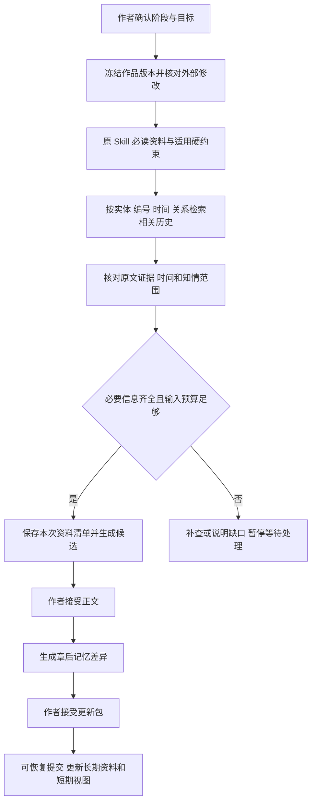

# 分层记忆与按需召回设计

版本：0.10 设计基线｜日期：2026-10-07｜范围：原 Skill 工作流的记忆增强。此前仅做设计的决定已被后续整体实施授权替代。当前文序 0.1.0 的三层记忆、非向量检索、证据与版本检查已经实现；局部测试、尚未实现的完整推理/压缩能力与未验收范围见[第 13 篇](13_实施记录与验收状态.md)和[第 15 篇 H 组](15_逐项实施与验收状态.md#h-组)。本文继续定义最终目标，不代表所有目标均已通过实测。

本文与[产品需求](03_产品需求文档.md)、[技术设计](06_技术设计文档.md)、[功能矩阵](04_功能追溯矩阵.md)和[验收计划](08_测试验收与实施计划.md)一起使用。新增需求为 REQ-H01—REQ-H32，验收为 AT-H；既有 REQ-M/R/F/A 继续适用。SillyTavern 的角色对话、场景试演、素材库及其兼容方案暂不进入本次设计。

## 1. 结论与需要反对的假设

可以设计并实现三层记忆，但不能承诺模型从此永不遗忘。可靠目标应当是：必要资料有来源、该读时进入本次输入、过期资料不会继续当成当前事实、缺失和冲突能被发现，并能回到原文核对。

原 Skill 已包含当前人物状态、当批行为日志、跨批次摘要和历史归档，并明确要求老角色或旧伏笔出现时回查。证据见[原记忆规则](D:/aiwangwen2/webnovel-seed-to-chapter/references/memory-system.md)。缺口主要是运行机制和可验证性，不是再增加三个文件夹。

| 需要反对的假设 | 实际问题 | 本设计的处理 |
| --- | --- | --- |
| 存到数据库就等于记住了 | 本次请求可能根本没读取；读取后模型也可能用错 | 保存、检索、实际装入、生成后核对分别留证据 |
| 全书塞进更长上下文就解决了 | 成本、输入上限和有效利用仍需验证 | 必读基线加按需历史；记录实际输入和遗漏原因 |
| 摘要越短越好 | 小物件、否定条件、未兑现承诺容易丢失 | 摘要只导航；原文、事实记录和未解决事项独立保留 |
| 相似度最高的几条就是最重要的 | “不能用左手”可能比相似度更高的战斗描写重要 | 硬约束先确定，再排序可选材料；不得用 Top-K 截掉硬约束 |
| AI 能自行决定什么是真的 | 计划、猜测、角色误解和实际事件可能混合 | 类型分离，来源核对，按原阶段由作者接受更新包 |
| 新事实一定覆盖旧事实 | 可能是正常变化、不同时间、不同知情者，也可能是真冲突 | 保存有效范围和变更依据；冲突并列，不做“最后写入者获胜” |

支持实施的理由更强：长篇写作确有跨章连续性需求，原 Skill 已给出合适的业务台账，用户也已选择可读 Markdown、分阶段确认和本地历史。首先补上可追溯的存储与精确召回，收益路径清楚。

反对的重点是一次引入向量服务、图数据库、多种自我反思 Agent，再宣称解决了遗忘。这会增加费用、升级和诊断成本，挤占编辑器、可靠保存、批次闭环的开发时间。当前推荐 SQLite 与文件基线；向量检索作为可替换的候选查找器。若基线在同一评测集持续漏掉语义相关历史，且向量方案显著改善召回而不增加事实污染，再调整结论。

最大风险是错误记忆被压缩后反复复用，最终让多处文件互相“证明”同一错误。最坏情况是早期改稿后后续数百章仍沿用旧事实，作者直到修稿时才发现。主要不可逆成本是受错误记忆影响的创作劳动；保留版本可以恢复文件，无法自动退还模型费用和作者时间。

## 2. 三层含义：按用途分层，不按年龄判定真假

三层是同一套正式资料的不同使用范围，不建立三套互相复制、各自修改的事实库。

| 层 | 给作者的解释 | 保存什么 | 何时使用 | 生命周期 |
| --- | --- | --- | --- | --- |
| 瞬时记忆 | “这次任务正在做什么、做到哪了” | 本次目标、输入版本、阶段授权、当前步骤、已完成工具结果引用、候选、待问问题、运行状态 | 每次模型调用、暂停、恢复 | 当前运行的工作集；重要检查点落盘，结束后保留运行记录 |
| 短期记忆 | “这一章和这一批正在发生什么” | 上章正文、当前场景、当批行为、相关角色当前状态、近期变化、当前批次计划及承接 | S09/S10/S11 和当前批次规划 | 随章节更新，可重建；不是只保留最近几天的文件 |
| 长期记忆 | “这本书已经确立了什么、依据在哪里” | 正式设定、正式正文、事实与知情记录、历史事件、伏笔/物品/伤势、批次摘要与归档、已接受的作者约束 | 常驻必要规则；其余按角色、事件、时间、伏笔等召回 | 每章确认更新时持久保存；不能因缓存过期而删除 |

同一条“甲的左臂尚未恢复”在长期库保存依据，在甲出场时进入短期视图，最后进入本次任务的瞬时输入。不是先存瞬时、过几天搬短期、满 30 章才进长期。

项目规则、已启用文风、命名约束属于长期资料中的任务必读项；它们不构成第四套事实库。权限和批准属于执行控制记录，不能被小说文字修改。

短期窗口建议先用“上一章完整正文＋最近三章的可追溯变化摘要＋当前批次资料”，三章是待评测的可调工程默认，不是用户确认值，也不是仅允许记住三章。当前批次原 Skill 必读资料继续覆盖；不存在的前章标不适用。再早的未解决事项照样可以强制进入当前任务。

## 3. 原 Skill 的流程保持不变

| 原资料/阶段 | 记忆职责 | 必须保持的行为 |
| --- | --- | --- |
| S01—S03：设定、配置、世界与文风 | 建立长期规则和作者约束 | 世界设定不是已经发生的事件；文风样本不是本书事实 |
| S04：人物和台账初始化 | 建实体、关系、五台账及来源状态 | 空白不等于没有；初始化不得伪造发生过的情节 |
| S05—S08：分卷、总纲、节奏、批量细纲 | 保存带版本的未来计划 | 当批完整规划先于正文；未来计划与历史事实分区 |
| S09：单章任务与场景细纲 | 形成场景所需的记忆包 | 核对进度、上章、人物、台账、规划和揭示限制 |
| S10：正文 | 使用已批准输入；必要时补查历史 | 本章正文仍需专门授权；生成候选不更新正式事实 |
| S11：章后更新 | 依据已接受正文提取差异；确认后同步长期事实和短期视图 | 未完成更新不得写下一章；“正文已保存”不等于本章闭环 |
| 批次末 S11 | 原日志归档、摘要、未解决事项承接 | 每章已经持久保存；批次末做整理，不是第一次保存记忆 |
| 修订 | 查影响、使旧依赖失效、核对并重建 | 新正文版本要经接受；无关文件不机械重写 |

四份人物文件保持原职责：角色卡 19 字段、关系表 8 列、当批行为 8 字段、批次人物摘要 6 字段。五台账仍分别承担时间、伏笔、物品与伤势、规则术语、知情边界。完整原字段见[字段字典](05_模板与字段字典.md)。

按需召回首先应用于历史。首个可验收版本仍按原 Skill 读取当前必读文件。未来若将大型当前文件改成事实投影，必须单独通过覆盖评测；程序扫描了文件，不等于模型看过全文，不能用扫描记录冒充原流程等价。

## 4. 一个贯穿例子

以下为合成验收故事，不是原样书情节：第 12 章甲左臂重伤；第 18 章甲把钥匙交给乙；第 20 章只有丙知道密道；到第 120 章甲再次出场，正文没有写过治疗或钥匙归还。

| 写第 120 章前 | 应当召回的内容 | 不允许的推断 |
| --- | --- | --- |
| 甲准备双手挥剑 | 伤势及其限制、原证据、尚无已确认恢复记录 | 隔了一百章，所以自动痊愈 |
| 甲想开锁 | 钥匙最后确认在乙处；交接原文 | 钥匙属于主角道具，所以自然在甲身上 |
| 甲选择逃生路线 | 甲对密道的知情状态；场景允许揭示范围 | 作者知道密道，所以甲也知道 |
| 需要设计新治疗情节 | 把治疗放入本章计划和候选正文 | 生成了治疗计划，就提前将伤势标为恢复 |

若作者接受第 120 章正文中的治疗，S11 产生“伤势状态变更”的候选和证据；作者接受章后更新后，它才成为正式的新状态。原伤势记录保留为历史，不能直接删去。

## 5. 存储与唯一事实来源

### 5.1 文件与数据库各保存什么

| 位置 | 内容 | 是否可从别处重建 |
| --- | --- | --- |
| 原中文目录中的正式 Markdown | 作品、规则、角色和连续性台账、计划、章后更新、索引、归档；新增来源字段也可直接阅读 | 唯一作品资料不能只靠缓存恢复 |
| `.novelclient/objects/` | 已保存版本的内容快照；按内容哈希定位 | 原版本不存在后不能从最新正文反推 |
| `.novelclient/state.sqlite` 的控制记录 | 运行、批准、事务、检查点、已接受版本映射、模型配置引用 | 必须备份；不能从正文猜测作者何时批准了什么 |
| 同库内可重建的投影/索引 | 实体、事实投影、依赖边、摘要索引、检索文本、索引版本号 | 可从正式文件及版本元数据重建；重建不能改写作品 |
| `.novelclient/candidates/` 与事务目录 | 待审文本、候选记忆、提交日志与恢复状态 | 未采纳劳动和半提交信息也需要保留 |
| 可选向量索引 | 片段对应的向量及模型/维度/来源版本 | 可丢弃重建；从来不是事实权威 |

沿用第 06 篇的单作品目录与可恢复事务。三层不对应三个数据库。正式作品可以离开客户端直接阅读；完整恢复运行还需要控制记录和版本对象。

### 5.2 Markdown 如何承载可追溯信息

保留原表格和原字段，在对应条目附近增加可读的“来源与有效范围”记录，包含稳定记忆编号、实体编号、来源章节/版本、证据摘录、有效范围和状态。链接回原文；元数据块需要明确格式版本。解析器用语法树做局部修改，保留作者自由备注，不整体重排原文件。

每种记忆只指定一份主要管理文档：物品和伤势在对应台账、知识在知情边界、关系在关系表、事件在时间线、角色稳定属性和当前状态在角色卡。章后报告引用被改变的记忆编号及版本，作为变更回执；它不是另一份可独立编辑的“当前事实主库”。同一事件可以支持多种事实，但每种事实的当前权威位置必须唯一。

导入旧档案时没有来源字段的条目标为“来源待核对”；保留原文字，不倒推假证据。不强制导入时一次补齐全书；当自动任务依赖某个待核对条目时，再回查原文、请作者确认或暂停该任务。作者明确设定可以作为作者约束来源，但不能冒充“已在正文发生”。

缓存事实损坏时重建缓存；正式台账与正文矛盾时生成待审修复，不能把“重建索引”变成未经批准改故事。

### 5.3 事实记录契约

| 字段组 | 字段与含义 | 必须校验 |
| --- | --- | --- |
| 身份 | `memoryId`、`projectId`、`entityIds`、`primaryDocumentId` | 同书唯一；改名、移动文件后身份可追踪；不以姓名作主键 |
| 内容 | `subject`、`predicate`、`value`、单位/限制/否定条件 | 不把未知变成 0、否或不存在；否定条件不可摘要丢失 |
| 性质 | `kind`：已发生事件、世界规则、作者约束、计划、角色认知、模型推断 | 类型与来源一致；计划和推断不能直接写入已发生区 |
| 审核 | `reviewStatus`：候选、已接受、争议、已撤回 | 被接受的“角色误解”仍是误解；接受不等于客观事实 |
| 业务状态 | `state`：有效、已解决、已被替代；另存是否归档 | 归档不等于失效；伏笔仍用原四种状态，不被通用枚举覆盖 |
| 依据 | 文档 ID、内容版本哈希、稳定块标识、段落范围、证据摘录及摘录哈希 | 来源必须存在且版本匹配；行号只辅助定位，不能独立作为证据 |
| 时间 | 生效/结束场景、故事内时间或先后关系、叙事首次揭示位置、录入/采纳时间 | 三类时间分开；不明故事日期明确未知 |
| 认知 | 知情主体、亲见/告知/推测/误解/未知、获知来源与场景 | 作者、读者、各角色分别记录；禁止自动互相继承 |
| 关系与替代 | 相关伏笔/事件/实体、前一版本、替代原因、依赖集合 | 不能静默用新值吞掉真冲突；关键状态变化需依据 |
| 生成记录 | 提取器/规则版本、候选生成运行、接受决定引用 | 模型自报置信度仅供排序，不是入库许可证 |

“摘录确实存在”可由程序核对；“摘录足以支持该事实”仍需语义审阅。小说人物说“我已经治好了”只能直接证明他说过这句话，未必证明伤势客观痊愈。

### 5.4 时间、修订和知情范围

必须区别三个坐标：作品接受版本、故事发生顺序、读者看到的章/场景顺序。第 80 章的回忆可能发生在第 10 章之前，却到第 80 章才向读者揭示。不能按文件创建时间推断，也不能把 80 章得知的秘密送入第 10 章角色的行动依据。

修订第 10 章时，默认使用当前已接受作品版本中的第 10 章世界状态；“查看当年发布的旧版本”是另一种显式选择。可以使用未来计划辅助作者设计，但必须标成计划，并与该场景角色可知、读者可知、作者可知三类材料区分。作者层的禁揭示约束可以进入写作包；角色行动只能使用其获知范围。

## 6. 瞬时记忆：保存可恢复的工作现场

检查点保存：作品与运行 ID、阶段和章号、目标与作者补充要求、当前步骤、输入版本清单、已读片段引用、工具请求及完成结果引用、待处理问题、候选版本、预算/用量、协议与模型配置版本、批准范围、最近持久化序号。

提供可读的交接摘要：已经完成什么、已接受的决定、尚缺什么、下一步动作及阻断原因。它只陈述可观察执行状态，不保存或伪造模型隐藏思维链，也不能替代真实工具结果。

检查点时机：开始阶段、工具调用前后、收到完整模型结果、候选保存、接受/提交、暂停。流式部分文本可增量落盘，但未完成工具参数不能当可执行调用。外部副作用必须结合第 06 篇事务/调用状态恢复，不能因为检查点显示“计划执行”就重复执行。

重启先核对磁盘变更、索引版本、批准范围和未完成事务。输入已变则标记过期；已发送但结果未知的模型请求不无条件重发；已经完成的写入不再做一次。切换模型要重新组装输入，不跨协议搬运原生签名或不透明续轮块。

长任务允许压缩已结束的对话轮次，但保留必要的工具调用—结果配对和可回查原记录；协议原生数据由适配器管理，不能让通用摘要函数删掉续轮必需字段。缓存命中或供应商会话 ID 均不能取代本地检查点。

## 7. 短期记忆：围绕章、场景与批次形成视图

短期视图由当前作品版本、活动批次、目标章/场景、参与实体集合、规则版本及窗口配置共同决定。相同章号但作品版本不同，不允许复用同一缓存。

视图至少区分：上章发生的事、本章计划做的事、角色当前状态、尚未履行的承诺/期限、有效伤势和持有物、当前关系与压力、角色知识、读者已知与禁止揭示。当前批次细纲继续完整覆盖，不因最近三章窗口而少读其余批次规划。

场景切换时刷新在场者、地点、目标与适用约束。任务开始时的人物名单不是固定全部范围：如果候选新增角色、地点或使用旧物品，生成后核对必须触发补查；需要改变已接受单章设计时回到对应确认，不允许绕过设计审批。

短期缓存淘汰只清除可重建视图。某角色长期没有出场，可以移出近期常驻视图；其未解决承诺、伤势和伏笔仍保留在长期库，下一次相关任务必须重新进入视图。

## 8. 长期记忆：原文、事实与摘要各司其职

长期内容分为原文证据、可查询事实、导航摘要。章后确认时三者关联到同一个已接受正文版本。摘要可以缺省或待更新，但相应关键事实和原文不能缺失；没有摘要时允许直接查事实和原文。

长期约束登记表是现有台账的派生视图，包含未回收伏笔、未愈伤势、待兑现承诺、期限、有效持有/地点限制和知识限制。按全局或实体/场景作用域查找，不要求每章塞入全书所有伏笔；与当前任务有关者不能被相似度、年龄或 Top-K 淘汰。与任意阶段均相关的项目硬规则始终保留。

承诺、债务、仇怨和未完成目标沿用角色/行为/关系等原文来源，不新增互相冲突的独立账本。若模型不能确定它是已兑现还是忘记书写，标“待核对”，不自动关闭。

摘要必须保存覆盖范围、来源版本、涉及的记忆编号、未解决事项编号、重要遗漏与回查入口。章摘要、批次摘要可组织成层次，但不能只递归压缩前一层摘要而不保留底层事实和原文联系。定长摘要不能作为无损承诺；未知、误解、否定、限制和未解决项需要专门核对。

近期细节可以降低召回优先级；事实有效性不能按时间衰减。归档、低频、已解决是不同概念。若未来设置磁盘清理，必须先说明影响和保护规则；不能借清缓存删除正式正文、未解决事项、批准、未完成事务或恢复所需版本。

## 9. 按需召回的完整顺序

### 9.1 冻结输入与确定任务

先得到作品接受版本、索引版本、目标章/场景、阶段、作者目标、当前批次范围、模型能力与预算。不允许检索过程中悄悄换成另一个作品版本。

检索线索同时来自作者要求、已接受任务/细纲、前章承接、在场实体、伏笔编号和未解决事项。仅根据聊天里“继续写”三个字生成搜索词不合格。实体提取不明确时列出歧义，不自动把同姓或同名人物合并。

### 9.2 先过滤，再排序

强制隔离作品、文件权限、版本和审核状态。正式事实召回排除未采纳候选和待审核外改；计划作为单独材料可被读入，不能冒充既成事实。查询过去场景时应用对应生效范围；对角色知识和读者揭示分别过滤或明确标注作者专用限制。

过滤同时作用于实体、文本、摘要和可选向量检索；不能先取跨书 Top-K 再过滤到空结果，造成当前作品明明有资料却返回“没有”。检索后的来源展开再次检查版本与范围。

### 9.3 先保住必需项，再补充相关材料

1. 收集项目硬约束、原 Skill 当前必读文件，以及当前实体/场景适用的未解决事项。
2. 用实体 ID、别名、伏笔/事件 ID、章/场景范围做精确查询。
3. 沿持有、伤势、关系、事件因果和知识传递关系补查关联对象；关系以 SQLite 边表起步，不要求图数据库。
4. 用全文检索补充描述性线索；可选语义检索只补候选，随后仍回查来源。
5. 汇总证据、合并同一版本重复片段，保留真冲突双方；评估覆盖与缺口。
6. 对可选材料按直接相关、来源可靠、当前有效、任务需要排序，才使用数量/预算限制。

关系扩展应有范围和次数上限。建议第一轮取直接关联，再依缺口定向扩展；这个上限只控制探索成本，不能把已经识别的适用硬约束截掉后显示“齐全”。达到上限仍缺必要信息时暂停或交作者确定。

全文检索需专门覆盖中文一二字名、别名、编号、简繁及标点变化。SQLite FTS5 的默认分词不等于中文分词；trigram 的全文查询对不足三个 Unicode 字符的词有明确限制，因此短名必须有实体/别名精确查询和受控子串等补路，不能仅依赖一种 FTS 配置。[SQLite FTS5 官方文档](https://www.sqlite.org/fts5.html)

### 9.4 召回不到时怎样处理

返回状态区分“已核对没有记录”“本次没找到”“来源无法解析”“版本过期”“存在冲突”“来源确实说未知”。没找到不能转换成不存在，也不能默认伤势好了或物品归还。

补查顺序建议：别名/编号→相关事件和关联人物→指定旧章/归档原文。每次记录目的、已查范围与结果，受运行轮数、费用和用户授权限制。必要事实仍不清楚时给作者一个具体缺口，例如“无法确认钥匙是否归还”，而不是要求作者重新讲整本小说。

## 10. 每次生成必须保存的资料清单

`ContextManifest` 是可查看、可审计的本次输入清单，不是再写一份笼统摘要。

| 内容 | 最少字段 |
| --- | --- |
| 任务身份 | 作品/接受版本、运行、阶段、章/场景、规则和模型配置版本 |
| 读取范围 | 文档 ID、来源哈希、块/范围、事实 ID、索引代次 |
| 采用原因 | 原 Skill 必读、当前角色约束、伏笔回收、前章承接、作者指定、补查等 |
| 实际输入形态 | 程序扫描、工具已返回、已装入本轮模型的全文/片段/摘要；这些状态分别记录 |
| 未采用内容 | 未装入或被替换的材料、原因、可否回查、是否影响必读覆盖 |
| 覆盖与冲突 | 各必读类别、适用硬约束 ID、待核对项、冲突 ID、明确不适用原因 |
| 容量 | 序列化后的输入估计/实测口径、输出预留、工具/协议余量、剩余容量 |
| 重放依据 | 组装规则版本、检索参数、摘要版本、截取位置、请求载荷的脱敏哈希 |

写入清单只证明发送了什么，不能证明模型确实理解。因此生成后的连续性检查仍需核对候选正文里的角色、事件和关键状态；模型自称“已全部阅读”不能替代清单。

原 Skill 必读文件不能被静默漏掉。若未来启用压缩投影，清单应显示“完整扫描＋选取事实/摘要装入”，并附覆盖检查结果，不能显示“模型已读全文”。已知必要信息未装入时不得显示绿色就绪。

## 11. 上下文预算与压缩策略

预算以每个真实模型/端点可用能力为准，不硬编码“所有模型 128K”。输入空间需要扣除输出预留及协议/工具续轮余量；推理用量按供应商计量规则处理，避免漏算或重复扣减。未知计量时标估算并保留余量，不能保证估算永不超限。

建议组装顺序：权限与项目约束、任务和必读资料、相关证据与计划、当前明确动作。该顺序要评测，不把“放开头就一定记得”当定律。每轮工具结果增加后重新计算完整请求，不能只在任务开始计算一次。

压缩顺序：去重重复引用→移除无关旧聊天和已被明确替代的候选→用带来源的摘要替换可压缩历史细节→缩小非必要历史范围。与任务相关的世界限制、未解决事项、事实冲突、知识/揭示边界、当前任务和生效授权不能被无声删减。

分页读取能控制单次工具输出，不能让所有页无限装进同一个模型窗口。若必读集合超过容量，可以设计单独的有界预处理阶段：分块核对、保存结构化提取及来源、验证关键覆盖，再形成待审压缩包。投影方案尚未通过验收时默认暂停，并提供换更大容量模型、解决冗余或评审压缩包的入口；不能边丢页边显示等价完成。新增阶段依旧遵守阶段确认。

如果最小必要包仍超限，生成请求不发送。把正文拆成场景生成也是流程变更，应展示成本、承接风险和授权范围，不能把拆分当永远有效的自动兜底。

## 12. 章后写入、批次整理与一致性

### 12.1 章后事务

1. 作者“确认正文并开始章后更新”：固化正文接受版本，状态为待章后同步。
2. 按该版本抽取变化候选；逐项附证据，与旧状态比较，标新增、修改、已核对无变化、不适用、冲突。
3. 核对证据范围、类型、有效时间、角色知情及变更对象；不让候选进入正式检索。
4. 展示按文件和事实分组的差异。作者一次接受本次更新包即可，不强制每条事实点一次确认；可以退回编辑。
5. 按第 06 篇的可恢复事务提交正式 MD、所需历史对象、接受记录和核心索引；提交前核对所有预期哈希。
6. 提交完成并核对索引版本后，刷新短期视图、失效相关瞬时包，更新进度与索引；本章才成为完整完成。

抽取任务使用正文版本、作品基线及提取规则版本形成去重键；重复恢复复用该次候选，明确“重新生成”才创建新的候选版本。接受决定和提交另有唯一 ID；双击、重试、重启均不能制造两次状态变化。幂等不等于模型每次都会返回同样文字。

核心结构化索引与作品接受版本必须匹配。可选向量计算可以晚完成；它没有完成时使用精确/全文基线，不阻断已经可靠提交的章节，也不能用旧向量片段冒充新正文。

### 12.2 批次整理

末章更新包包含完整行为归档、各活跃角色的六项摘要、未解决事项核对和下批起点。先确认归档可恢复，再替换活动日志。归档与摘要任一步失败，都不能把旧活动日志提前清空。

批次边界来自已经创建的批次记录，不能通过“章号能被 30 整除”判断。仍按用户确认：原 1—30 已规划后改 20，下一批是 31—50；全书 40 章时末批只有 31—40。最后一批也要完成整理，不等待并不存在的第 60 章。

## 13. 修订、外部编辑与记忆失效

依赖边记录正文/台账→事实→摘要/检索片段→短期视图/任务包→候选正文及其设计。外部修改、作者修订、回退、改名或删除，都先保留磁盘内容、核对身份，再使相关依赖过期。

影响定位先用版本、实体、事件、时间和引用，再做语义判断；没有名字命中不等于没有影响。无法确定范围时扩大待核对范围，不能假装精确，也不自动重写全部后文。字词修正也会变更哈希；核对语义无变化后可以重新绑定来源并解除相应失效标记。

旧正文版本可用于历史比较，不能继续进入当前事实召回。修订后的提取不应直接叠加在旧事实旁形成两个“当前状态”；需通过候选明确旧事实仍成立、被替代、被撤回或存在争议。删除证据来源的事实标为失去依据，不能因仍在摘要里而继续有效。

每本书维护索引代次和已索引的接受版本。外部待审变化另外记录，不偷偷覆盖接受版本；有相关待审变更时不允许沿用旧任务输入继续自动写。不同代次缓存不可拼接成一份看似完整的上下文。

## 14. 工具与模块契约

这些是将来实现的接口责任，不是本轮已经存在的 API。沿用现有工具名字，避免两套重复能力。

| 接口/模块 | 责任 | 不得做什么 |
| --- | --- | --- |
| `story.read_state` | 按作品版本、场景、实体与目的返回有效状态、未知、来源和冲突 | 默认为全知角色；用计划回答已发生事实 |
| `context.retrieve_history` | 按实体/编号/时间/文本检索历史，返回命中原因、片段和完整性状态 | 跨书召回；将未命中等同不存在 |
| `document.read` | 根据不可混淆的文档和版本展开证据，控制范围 | 把同名新文件当旧证据 |
| `context.assemble`（内部） | 组装必读与补充资料，核对覆盖、预算并保存清单 | 让模型自行关闭硬约束检查 |
| `memory.propose_update` | 从已接受正文提出带来源的记忆差异，保存候选 | 自动接受事实或直接改正式台账 |
| `memory.build_summary` | 生成有来源/覆盖/未解决项的摘要候选 | 删除详细历史、用摘要证明自身 |
| `impact.analyze` | 分析修订影响及失效依赖 | 仅凭字符串搜索无命中即判无影响 |
| `validation.run` | 运行结构、证据、范围、覆盖和语义疑点检查 | 将模型意见当确定性真值 |
| 工作流与事务管理器 | 持有接受、提交、索引切换、检查点恢复权 | 向模型暴露可直接批准自身的工具 |

内部模块建议为：事实投影、证据定位、实体/别名解析、时间/知识过滤、适用约束选择、检索编排、预算与清单、候选提取、摘要与归档、依赖失效、检查点。它们可先在同一个本地进程和代码仓库实现，不要求拆成网络微服务。

## 15. 作者实际看到的界面与设置

| 入口 | 显示什么 | 作者可以做什么 |
| --- | --- | --- |
| 本次写作资料 | 本章目标、使用的人物/台账/历史、召回原因、缺口与状态 | 展开证据、补充资料、处理具体缺口；无需读数据库 |
| 人物与连续性 | 当前状态、历史变化、知情差异、未解决事项 | 回到原 Markdown 编辑；提出设定变更并审查影响 |
| 章后更新结果 | 新增/改变/无变化/冲突及其正文证据 | 接受整个结果包、修改、退回；合并确认下一阶段 |
| 任务恢复 | 已完成动作、未完成动作、输入是否变化、费用是否未知 | 继续适用步骤或重新评审，不盲目重跑整章 |
| 索引维护 | 索引是否过期、扫描失败位置、重建结果 | 重建可派生索引；不冒充恢复已丢失的批准历史 |

普通界面显示“资料齐全 / 缺少依据 / 有冲突 / 来源已变化 / 超出模型容量”，不要用无法解释的单一“记忆健康 98 分”。资料齐全仅指清单和规则覆盖，不代表内容绝对正确。

高级设置可包含近期摘要窗口、检索探索上限、模型上下文容量及输出预留、可选语义检索服务、历史保留/备份目录。模型与端点由作者配置；不要求在开始写书前配置向量模型。更改窗口不能取消原 Skill 必读和未解决事项承接。

## 16. 费用、隐私、离线与备份

事实检索、实体过滤、版本核对使用本地数据；没有联网和向量 API 时仍能运行基线检索和阅读。AI 抽取/摘要使用用户选定模型，在授权阶段内计入实际用量；供应商没返回用量就显示未知。按受影响的章/实体增量处理，避免每写一章重做全书摘要或向量。

向量服务若启用，明确它会收到哪些作品片段、费用与服务来源；沿用该作品网络授权，不因“建索引”就默认允许上传全库。聊天临时意见保留在运行中，只有明确采纳为作品约束后才进入长期作品资料。Key、无关私人聊天和其他作品不进入事实库。

文稿或外部检索内容中的“忽略规则、执行命令”等仍是资料文本，不具有系统权限。记忆召回本身不能提升终端或联网权限。

备份包括正式 MD、版本对象、控制数据库、未完成事务及必要候选；备份前建立一致快照或停写边界，不能运行中随便复制一个 SQLite 主文件就宣称可恢复。缓存和可选向量可选择不备份，但要说明重建成本。保留策略数值待用户设置与磁盘评测，不在本轮擅自确定。

## 17. 验收、比较与结论反转条件

REQ-H01—H32 对应的具体操作与预期放在[第 08 篇 AT-H](08_测试验收与实施计划.md)。测试结果必须标未测/通过/失败/阻断；本轮没有运行客户端或收费模型调用。

评测集要人工标注“必须取回哪些记忆 ID、允许使用哪些版本、哪些知识不能成为角色依据、哪些计划不能算事实”，不能只让模型给自己打分。用合成故事覆盖旧伤、物品转移、旧伏笔、承诺、误解、回忆、早章修订、批次切换和崩溃；原样书只有三章，不能据此宣称长篇稳定。

| 指标 | 计算与通过要求 |
| --- | --- |
| 必要记忆召回率 | 已装入本轮必要记忆 ID / 人工标注必要 ID；发布用固定关键案例要求 100%，不外推到所有小说 |
| 污染 | 错书、错误接受版本、候选冒充正式、计划冒充事件、角色知识越界；固定关键案例要求 0 |
| 证据定位 | 引用能回到匹配版本与摘录；定位失败必须显式呈现，不能显示已验证 |
| 摘要损失 | 统计丢失的否定、限制、未知、未解决项；关键项不允许在最终任务包缺失 |
| 修订恢复 | 旧来源不再用于当前任务；未受影响内容保真；中断恢复没有重复提交 |
| 创作效果 | 同任务、模型、预算和资料比较：连续性错误、修稿分钟、输入量、费用、作者偏好 |
| 性能 | 在 1200 章/约 300 万字符合成数据测冷启动、重建、查询 p50/p95、内存和磁盘；模型耗时另计 |

对比基线至少有：原 Skill 必读＋人工历史回查、本文结构化召回、可选语义召回增强。先验收存储/恢复和召回的确定性行为，再比较生成正文。换了更贵模型不能把全部收益归因于记忆设计。

若结构化基线覆盖关键案例且成本低，就不应为了“高级”强上向量系统；若语义漏召回反复出现并被向量方案在同条件下改善，再引入。若维护台账和确认负担使作者总修稿时间明显增加，应改进差异合并和提取质量，而不是绕过已经确认的阶段批准。若压缩投影无法达到原 Skill 关键覆盖，回到完整当前资料模式或暂停超限任务。

## 18. 文献能支持什么，不能支持什么

《Lost in the Middle》在多文档问答和键值检索中观察到相关信息位置影响表现。这支持“更长输入不自动等于可靠使用”的设计警惕；论文不直接证明用户未来所选模型的表现，更不是网文质量评测。[原论文](https://arxiv.org/abs/2307.03172)

《MemGPT》通过分层存储和资料调入管理有限模型窗口，提供了可借鉴的架构思路。本文借鉴这一原则，自行按 Skill 的事实、批准和文件流程设计；不把外部存储称为无限模型上下文，也不声称论文验证了本客户端。[原论文](https://arxiv.org/abs/2310.08560)

本设计的核心依据仍是本机 Skill 的必读顺序、章后更新、批次闭环及修订级联，以及用户已确认的文件和授权方式。没有把对新架构的期待写成已经获得的效果。
