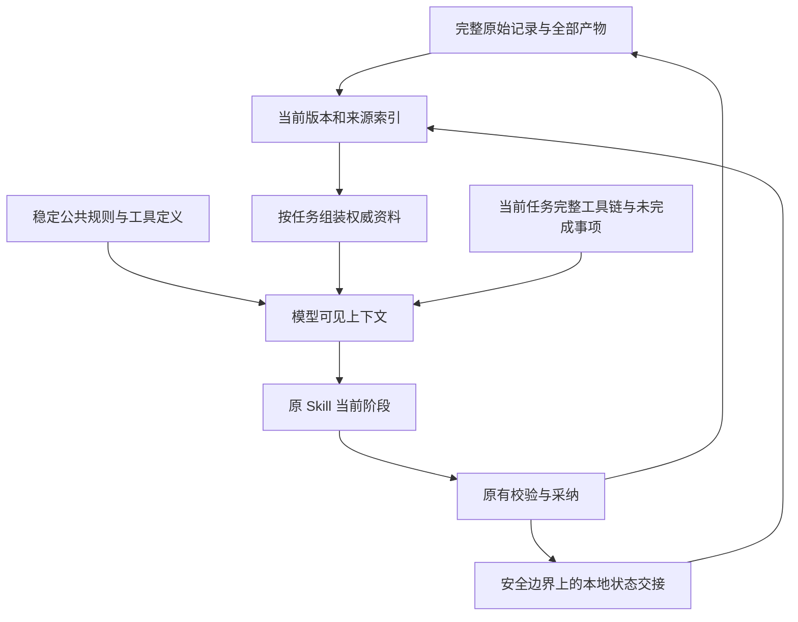

# 上下文压缩设计：死亡权工作流

日期：2026-10-24。基于当前 0.4.55 客户端源码、0.4.54 冻结实跑的 21 次请求，以及固定版本的公开源码。

状态：完成源码核查、离线请求重组和设计；尚未接入客户端，未发送新的创作或压缩请求。离线重组不是新的完整实跑，也没有验证压缩后的文学质量或速度。本次不改变客户端版本、模型、推理强度、12 轮上限和 Skill 文件。

## 1. 结论与证据

推荐采用“已采纳文件作为权威状态 + 当前任务完整历史 + 稳定公共前缀”的组合。先用确定性的本地上下文重组移出已关闭阶段的执行历史，再为确有需要的长任务保留可选的模型压缩后端。不能把小说设定、人物事实、正文证据统统改成模型摘要。

当前问题不是完全没有上下文管理：`context-compiler.ts` 已按章、范围、知情边界和版本选材；`prompt-cache.ts` 已去重相同来源和公共规则；`cache-session.ts` 已复用原生推理及工具历史。缺口是：跨阶段持续追加旧执行轨迹，达到可用输入预算的 85% 才重建；正文、审稿、记忆和证据核对又从完整规划历史分支。大容量下，“装得下”并不表示“值得继续携带”。

0.4.54 实跑为 70 分 23.188 秒，21 次请求，输入 2,812,500 tokens，实际缓存 92.9018%，推理输出 50,125 tokens。0.4.51 为 50 分 04.278 秒、同样 21 次请求、推理输出 23,746 tokens。两次非推理输出接近，但推理量与首次正文/工具参数出现前的等待明显增加。这支持继续调查上下文负担和任务复杂度，不能单凭相关性认定“长上下文导致全部延迟”，也不能把这段等待全部当成 TLS 或纯推理耗时。

原始 Codex Skill 样本使用 gpt-6-astra/ultra，客户端样本使用 gpt-6.1-sol/high，且原样本已有热会话。原先 15 分 19.839 秒只能作为历史参照，不能据此分离出客户端本身造成的精确倍率。

相关本地证据：

- [完整实跑统计](D:/AIkehuduan/output/harness-stream-idle-20261023/final-runtime-analysis.json)
- [首个输出前后时间拆分](D:/AIkehuduan/output/harness-stream-idle-20261023/stream-timing-analysis.json)
- [本次离线重组结果](D:/AIkehuduan/output/context-compaction-design-20261024/offline-replay.json)
- [可复现脚本](D:/AIkehuduan/output/context-compaction-design-20261024/replay-context.ts)

## 2. 三套参考的适用范围

| 参考 | 已核对内容 | 采用的设计 | 不直接照搬的部分 |
| --- | --- | --- | --- |
| Codex，固定提交 `ea819e1f4d0759777106e5a6fb9984752b20f972` | `compact.rs` 中的历史重建、当前环境合并、压缩记录、模型标识和计数更新 | 压缩必须形成有版本的状态交接，恢复时重新装入当前约束与环境 | 不沿用其旧用户消息的通用裁剪策略；本项目原始设定和作者硬约束必须独立固定保留。其网络重试分支也不覆盖本项目“未知结果不自动重发”的规则 |
| DeepSeek Harness，固定提交 `687f282e8625c6b8d11ff58211a90524be2e4317` | `region.ts`、`config.ts`、`summarizer.ts`、`index.ts` | 完整事件记录与模型可见视图区分；切分不得拆散工具调用和结果；版本稳定后原子提交；失败保留旧视图；压缩后必须更小 | 不照搬固定 65,536 token 余量、每次自动重试或大摘要预算；阈值要适配当前任务与实际计量 |
| Claude Code | 官方公开仓库完整目录、README、商业许可；官方上下文管理文档 | 先清理旧工具信息，再按需要摘要；长期规则独立存放；工作文件按任务读取；防止压缩后立即再次压缩的循环 | 公开仓库没有可核对的压缩引擎实现，仅有相关界面测试夹具。不能声称复刻了其压缩核心源码；研究文章中的具体策略也不能当作当前所有版本的实现保证 |

源码依据：[Codex compact.rs](https://github.com/openai/codex/blob/ea819e1f4d0759777106e5a6fb9984752b20f972/codex-rs/core/src/compact.rs#L84)、[DeepSeek region.ts](https://github.com/deepseek-ai/deepseek-harness/blob/687f282e8625c6b8d11ff58211a90524be2e4317/packages/compaction/compaction-basic/src/region.ts#L107)、[DeepSeek config.ts](https://github.com/deepseek-ai/deepseek-harness/blob/687f282e8625c6b8d11ff58211a90524be2e4317/packages/compaction/compaction-basic/src/config.ts#L68)。Claude 的依据是[官方文档](https://code.claude.com/docs/en/how-claude-code-works#when-context-fills-up)和[官方上下文工程文章](https://www.anthropic.com/research/effective-context-engineering-for-ai-agents)。源码快照及许可位于本次 `output/context-compaction-design-20261024/research/`；没有把第三方实现直接复制进产品。

DeepSeek 的摘要调用会尽量沿用原会话的系统指令、工具及消息前缀，把摘要指令追加到末尾。可借鉴这一布局以争取缓存复用，但缓存命中仍由供应商决定；摘要替换旧历史之后，不能假定后续请求仍命中被替换的整个旧前缀。[summarizer.ts](https://github.com/deepseek-ai/deepseek-harness/blob/687f282e8625c6b8d11ff58211a90524be2e4317/packages/compaction/compaction-basic/src/summarizer.ts#L123)

## 3. 离线重组：有多大空间

方法：读取 0.4.54 捕获的每个任务原始 `system/messages/tools/wireBody`，用当前 `cacheableInput` 重建该任务的输入；保留原请求其他设置、全部当前资料和当前任务内原生消息，只移出继承的旧阶段历史。没有模拟新模型输出，也未删除原实跑中的补丁恢复轮次。

| 方案 | 21 次请求 JSON 总字节数 | 比原记录减少 |
| --- | ---: | ---: |
| 原始捕获 | 15,954,773 | — |
| 只让 S10 各子任务不继承旧规划执行历史 | 8,791,791 | 44.90% |
| 只重建 S01—S09 的阶段交接 | 11,688,092 | 26.74% |
| 每个任务边界都重建 | 4,525,110 | 71.64% |

例如 S10 正文请求由 1,100,010 字节变为 195,834 字节，审稿请求由 1,115,174 字节变为 193,906 字节。全部 21 个投影都通过：原始设定保留；当前资料的路径、版本、内容与范围逐项一致；任务内 native 消息原样保留；工具调用和结果成对闭合。

这些是 **JSON UTF-8 字节数，不是 token、命中率或速度预测**。其中原请求加密字段共 7,391,304 字节，投影后 633,972 字节；加密文本长度不能当作模型 token。该实验也没有证明所有有价值的创作决策都已落入文件，因此“每个任务边界重建”是结构性上界实验，不是已通过质量验收的发布策略。

复现：在 `D:\AIkehuduan` 执行 `node --import tsx output/context-compaction-design-20261024/replay-context.ts`。只读旧请求，结果写入本次输出目录，不访问模型服务。

## 4. 目标结构

完整记录仍保留全部请求、原始输出、错误、时间和采纳过程。压缩只改变下次模型请求所看到的视图，不删除原始证据、不改写旧记录、不改变对作者输出的文件结构。

新的可见上下文由四层组成：

1. **稳定规则层**：总控、当前适用的公共表达规则、命名规则和工具定义，按内容哈希固定顺序。原始设定保留用户资料身份；不能提升为系统授权。
2. **权威资料层**：从正式快照或明确绑定的候选版本装入当前任务必读文件及原有合法选段。文件内容只出现一次，版本、范围、来源类别和知情边界仍保留。
3. **工作状态层**：已完成章节范围、草稿哈希、待修复问题、未决作者要求、尚未解决的冲突。能从现有文件字段确定的内容本地生成，不新增“请再总结一次”的请求。
4. **当前执行层**：当前任务的原生推理、工具调用、结果及必要的连续对话，保持完整。只有进入安全边界后才能处理已关闭的旧执行链。

已有的 `sourceMaterialization`、`contentRef` 和公共规则引用可能依赖旧历史。切换上下文时必须先从已采纳文件或确切候选重建原文，核对 hash/ranges，再发出引用；不能移除底稿却留下“见前文”。

## 5. 按写作职责保留什么

| 职责 | 必须保留 | 可从下一任务常驻输入移出的内容 |
| --- | --- | --- |
| S01—S03 设定、配置、世界规则 | 用户原始设定、全部硬约束、已确认选择、适用规则、当前必读文件 | 已关闭阶段的工具日志、过期候选、重复回执 |
| S04 人物与台账初始化 | 角色、关系、行为、五类连续性台账及各自状态与证据 | 已被正式文件完整表达的旧创建过程 |
| S05—S08 分卷、总纲、节奏、批次细纲 | 原 Skill 要求的当前批次全体章节和全局规则；已完成段落与草稿版本 | 旧批次不相关执行过程；不能只留“总纲已完成”几个字 |
| S09 单章任务和细纲 | 当前 30 章批次关系、本章任务、场景安排、节奏与揭示边界 | 与当前任务无关的历史工具轨迹 |
| S10 正文 | 本章任务和细纲、适用文风、真实人物状态、前章必要衔接、硬规则与秘密边界 | 生成前面各份纲要时的执行历史 |
| 审稿和证据核对 | 待审正文完整原文及 hash、检查项、相关计划与事实证据、有效修订 | 作者模型的自评和无关规划推理；不能用正文摘要代替待审正文 |
| 章后记忆及续写交接 | 候选正文、九类记忆文件的当前权威版本、精确证据、待更新字段、后续计划影响 | 已落盘旧版全文的重复序列；增量必须能还原当前版本 |

“顾平安持有自己的 00000 号死亡权”“上次死亡时间七年前”及作者的终极世界观仍作为设定/揭示约束；不能因摘要把后期真相写成人物当前已知。计划中的母女交易不能自动升格为已发生事实。死亡责任规则、转移和继承条件中的否定、例外、数字都必须保留原义与来源。

原 Skill 的 11 阶段职责、必需文件、模板字段、30 章覆盖和字数/视角检查不变。客户端当前将部分 Stage 11 职责合并在 S10 管线中，验收应逐项对照职责和产物，不能仅凭界面阶段名宣布完全一致。此次压缩设计本身不解决已有的阶段编号差异，也不能借机省略审稿。

## 6. 触发与提交

引入两个独立判定：容量判定防止溢出；性能判定决定已关闭历史是否还值得携带。不能继续只使用“大窗口的 85%”，也不能把 UTF-8 保守上界当作真实 tokens。

首批实施建议只处理 S09→S10 及 S10 职责切换：这些边界原本就创建独立任务，已具备明确输入。之后再扩展到 S01—S09 已采纳阶段的交接。阶段内不每轮重建，保持前缀稳定，保留当前原生历史。

每个边界先构造候选视图并测量，但只在收益明显且信息覆盖通过时提交。离线实验可试“候选比现状至少小 25%”作为防止频繁重建的初始门槛；这只是待评估参数，不是已验证最优值或 token 延迟规律。小任务继续复用，不为了压缩而添加新请求。有效前缀一旦换代，当前任务后续轮次只追加新信息。

提交过程：

1. 确认当前流已终止、工具调用与结果已闭合，没有未知结果的请求；记录正式快照、候选 hash、规则版本和来源序号。
2. 本地组装候选；将依赖旧历史的来源完全还原；保留所有未决作者指令和任务状态。
3. 检查来源完整性、指令身份、必读覆盖、候选/正式状态、范围、工具配对和容量；候选必须确实更小。
4. 再次核对快照与草稿未变，原子记录 `context/checkpoint` 并绑定新的前缀。若期间版本变化，丢弃候选视图而不覆盖旧状态。
5. 保存压缩原因、前后字节/计数方法、保留及移出来源、耗时、可恢复的旧视图引用。

建议复用现有 `FileStore` 对象库和版本体系，不再另建一套事实库。检查点最少包含：policyVersion、project/branch/snapshot、stage/phase、来源 path/hash/ranges/category、规则与工具版本、nativeTailRef、draftHash/completedRanges、未决问题引用、旧事件引用和前后计量。模型需要的权威内容必须实际装入，只有哈希或文件名不够。

长阶段中途需要压缩时，S06/S08 的已写内容、`final:false`、完成章节集合和下一段边界必须恢复。尚未完成的工具链整段保留。未知请求结果仍按原恢复策略处理；压缩不能把未知状态变成“失败，可以重发”。

## 7. 模型摘要和原生 compact 的位置

本地状态重组默认新增模型请求数为零。只有剩余必要对话无法由已采纳文件和当前状态表达、且确实触及容量压力时，才考虑摘要后端。摘要只承担交接信息，不成为故事事实、审稿通过凭证或作者授权。摘要有独立长度上限，不能反复“摘要套摘要”膨胀；每次从可追溯原始材料重建，缺项或截断则拒收。

OpenAI 官方提供两种机制：`context_management` 在 Responses 请求内触发服务端压缩，以及独立 `/responses/compact`。两者的返回处理不同：独立 compact 返回的整个窗口应原样用于后续请求，不能只摘出加密项；服务端自动压缩的手动输入数组链按官方说明处理最新压缩项之前的历史，使用 `previous_response_id` 时不手动删历史。[官方 Compaction 文档](https://developers.openai.com/api/docs/guides/compaction)

当前链路是 Sub2 到 ChatGPT/Codex OAuth，不能凭“兼容 Responses”推断两种机制都可用。本次没有向该链路探测或发送压缩请求。接入时需要区分：普通 Responses、原生 compact、自动 compaction、加密项续传、usage 计量，以及 SSE/WebSocket 的事件支持；能力未知时使用本地方案。原生加密项不解码、不伪造、不任意剪碎。

若后续引入模型摘要，其调用、耗时和使用量全部记入实际运行及预算，不把它藏在准备时间中；不自动扩大 12 轮上限，不在未知结果后自动换后端重复提交。服务端自动压缩即使没有增加独立 HTTP 请求，也可能增加服务端处理时间；若网关未提供可分离的压缩用量/耗时，应标记无法拆分，不能记成零。

## 8. 缓存和重复审查

公共规则仍固定在前面，任务动态信息放后面；一次压缩形成一个稳定的新前缀，在该任务内连续复用。正文和审稿的表达规则目前直接拼接到专项提示，可进一步拆成内容相同的公共模块与各自适用部分；只有原文及适用条件均一致时才共享，不能因“看起来重复”删掉规则。

`review-receipts.ts` 已有同输入回执复用，不能再为它包一层额外审查。保留现有以输入、阶段、版本、指令和模型绑定为依据的缓存；新增压缩策略后核对 parser/contract 版本也在失效范围内。正文或相关事实证据变更，旧回执必须失效。重复展示可以本地精简，实质检查不能省。

整体缓存率仍按 `sum(cached_input_tokens) / sum(input_tokens)` 统计，包含冷启动和所有真实辅助调用，95% 目标不改变。把已缓存的冗余内容移出后，分子与分母会同时减小，比例可能下降，即使实际负担变轻。因此同时报告总输入、未缓存输入、推理输出、正文输出、真实耗时、请求数和缓存率；不能用补齐无用上下文、预热请求、排除首轮或平均单请求百分比来凑 95%。当前方案不能保证达到 95%，必须真实验收。

## 9. 代码落点与验收

| 位置 | 后续实施内容 |
| --- | --- |
| `src/core/runtime/cache-session.ts` | 在相邻阶段/正文分支选择复用或检查点；绑定前缀代次；不在活动工具链中间切换 |
| 新的 `src/core/runtime/context-checkpoint.ts` | 本地状态快照、来源还原、完整性核对、原子提交与回滚 |
| `src/core/context-compiler.ts` | 继续使用现有任务范围与必读规则；输出可审计覆盖清单，不另写第二套选材规则 |
| `src/core/context-budget.ts` | 容量预算与性能触发分离；分别记录 provider usage、可靠本地分词或字节上界 |
| `src/core/runtime/prompt-cache.ts`、`runner.ts` | 保留公共规则原文；安全重组 S10 输入；审稿不继承作者模型的自评 |
| `review-receipts.ts` 及调用绑定 | 验证跨版本失效；相同有效回执本地复用，减少展示而不减少检查 |
| 模型网关与遥测 | 增加 checkpoint 原因、旧新规模、组装时间；未来若接入原生 compact，再添加独立能力与用量记录 |

实施顺序：先零新增模型请求的 S10 边界重组与规则去重，再扩展已采纳规划阶段；在确定性方案不足的证据出现后才评估摘要后端。

必要回归包括：旧底稿移出后 contentRef 可解析；当前正式/候选 hash 不串用；S06/S08 分段恢复不重复前 10 章；工具配对与原生项不损坏；外部修改/用户修订使检查点失效；正文完整证据保留；计划、事实、秘密和人物知情不混淆；回执不会因上下文压缩被重复请求；压缩失败继续使用原状态且不循环；新进程能按事件与对象恢复。

完成代码与离线回归后，才冻结版本做独立死亡权完整验证。实跑从启动该独立创作运行开始计时，包含首次资料组装、全部生成、审查、工具处理和压缩耗时，另列每次模型请求；开发、构建、测试、人工等待单列。保留完整原始与作者可见产物，对照原 Skill 必需文件、字段、表格列、30 章范围、正文长度和视角、章后九类台账与续写交接。人工复核规则可执行性、智斗因果、角色动机、伏笔与揭示节奏；结构校验通过不能替代文学质量评价。

离线重组通过只证明指定信息与工具结构保留，不能宣告生产优化完成。只有在上述质量与结构检查不退化、真实耗时下降、实际总缓存率达到要求后，才能报告本轮目标全部达成。
